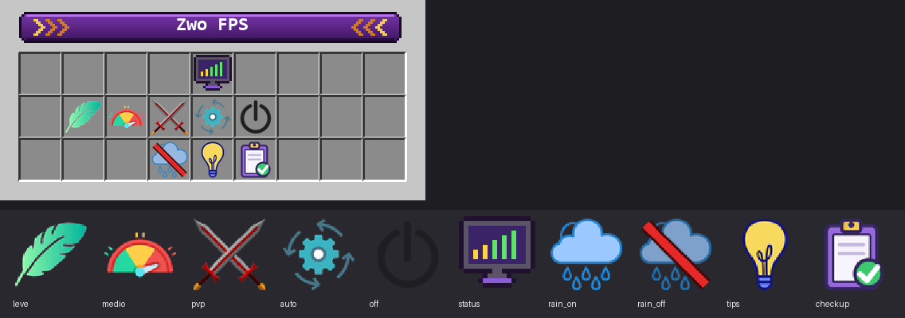

# Zwo FPS

A **Paper 1.21.11** plugin that helps players on low-end PCs get more FPS by reducing what the
server **sends** to the client: fewer chunks, fewer piled-up entities and no rain.
It does not touch the world, mobs, farms or server ticking.

> The server cannot measure a player's FPS. That is why Zwo FPS only acts on things that
> demonstrably weigh on client rendering and can be controlled without mods.

## What it does

| Feature | How it works |
|---|---|
| **Per-player sent chunks** | `Player#setSendViewDistance`: the client only renders what it receives. It does not change the loading view-distance or the simulation-distance, so farms, spawning and redstone keep working the same. |
| **Distance + budget culling** | Per category (displays, holograms, frames, armor stands, dropped items, animals, villagers): hides whatever is farther than `hide-beyond` blocks and keeps only the `max-visible` closest ones visible. Near the player (`always-visible-radius`) nothing disappears, because that is where they interact. |
| **A real automatic mode** | Reads the render distance and particle setting the client itself reports (`ClientOption`). If the player lowers their settings, the profile adjusts instantly; with the game on high settings, nothing changes. |
| **Clear weather** | Hides rain/snow (lots of particles) per player. Each player can turn it back on in the menu. |
| **Protections** | Never hides players, entities with the `zwofps_keep` scoreboard tag, entities carrying passengers, or names/TextDisplay texts containing `NPC`, `LOJA`, `QUEST`... |
| **Client-aware tips** | `/fps dicas` uses the client brand (vanilla, Fabric, Forge, Lunar...) and its options to suggest what actually gives FPS (e.g. Sodium for vanilla players). |
| **Low-end PC hint** | On login, players with low render distance/particles and no active mode get a clickable button to enable it (with a cooldown). |
| **Hotspots for staff** | `/zwofps hotspots` lists the loaded chunks with the most entities and tile entities, with click-to-teleport. |

Preferences are stored in the player's **PersistentDataContainer** (saved with their player data,
no extra files and no IO on the main thread).

## ClearLag

Zwo FPS **does not remove entities and does not touch AI**. That is server load and already
ClearLag's job. The two work on different layers:

- **ClearLag:** removes/limits entities and controls AI (less work for the server).
- **Zwo FPS:** decides what each client receives and renders (less work for the player's PC).

When ClearLag removes something that was hidden for someone, Zwo FPS cleans up its own state
through `EntityRemoveEvent`.

## Commands

| Command | Permission | Description |
|---|---|---|
| `/fps` | `zwofps.use` (everyone) | Opens the menu |
| `/fps <leve\|medio\|pvp\|auto\|off>` | `zwofps.use` | Changes the mode |
| `/fps status` | `zwofps.use` | Mode, applied profile, sent chunks, weather and client settings |
| `/fps dicas` | `zwofps.use` | Tips based on the player's client and settings |
| `/fps checkup` | `zwofps.use` | Check-up of the player's own game (render distance, particles, client, sent chunks) with a recommended mode |
| `/fps chuva` | `zwofps.use` | Shows/hides rain |
| `/zwofps stats` | `zwofps.admin` | Modes in use, total hidden, average scan cost, MSPT |
| `/zwofps check <player>` | `zwofps.admin` | A player's status and client, including hidden entities per category |
| `/zwofps area [player]` | `zwofps.admin` | Entities within 64 blocks of a player |
| `/zwofps set <player> <mode>` | `zwofps.admin` | Changes someone's mode |
| `/zwofps hotspots [world] [amount]` | `zwofps.admin` | Heaviest chunks |
| `/zwofps reload` | `zwofps.admin` | Reloads the config |

Players never get information about what is around them (entity counts near a player reveal
bases and farms). That census is staff-only (`/zwofps area`, `/zwofps check`).

Command arguments and in-game messages are in Portuguese by default; all messages can be changed
in `config.yml`.

## PlaceholderAPI

`%zwofps_mode%`, `%zwofps_profile%`, `%zwofps_hidden%`, `%zwofps_send_distance%`

`%zwofps_hidden%` counts entities hidden around the player, so avoid showing it to players
(scoreboards, tab) for the same reason.

## Menu icons (resource pack)



The [`resourcepack/`](resourcepack) folder has custom 64×64 icons for the menu
(pack format 75, Minecraft 1.21.11), using the `item_model` component:

1. Send the pack to players (server.properties, or merge the `assets/zwofps` folder into the pack
   you already use with ItemsAdder, Nexo, CraftEngine, etc.).
2. In `config.yml`, set `menu.resource-pack-icons: true`.

With that option on, the menu title also uses `menu.title-with-pack`, which draws a banner
(font `zwofps:menu`) behind the text.

Without the pack, leave it `false`: the menu uses vanilla items and the plain title. Each profile
has its own `item-model` and the fixed buttons live in `menu.item-models`, so any icon can be
swapped.

The title banner is generated by [`tools/draw_banner.py`](tools/draw_banner.py) (Python + Pillow).
[`tools/draw_icons.py`](tools/draw_icons.py) draws the original 16×16 pixel-art icons (status still
uses one of them):

```
python tools/draw_icons.py resourcepack/assets/zwofps/textures/item docs/icons-preview.png
```

## Configuration

Everything lives in `config.yml`: categories (which `EntityType`s go into each group), profiles
(send distance, weather and per-category rules), automatic mode rules, protections, scan
performance limits and MiniMessage messages.

The scan is spread across ticks (`max-players-per-tick`, `max-millis-per-tick`) and the interval
doubles automatically when MSPT goes above `slow-down-if-mspt-above`.

## Build

```
./mvnw package
```

The jar ends up in `target/ZwoFPS-<version>.jar`. Requires Java 21 and Paper 1.21.11.
